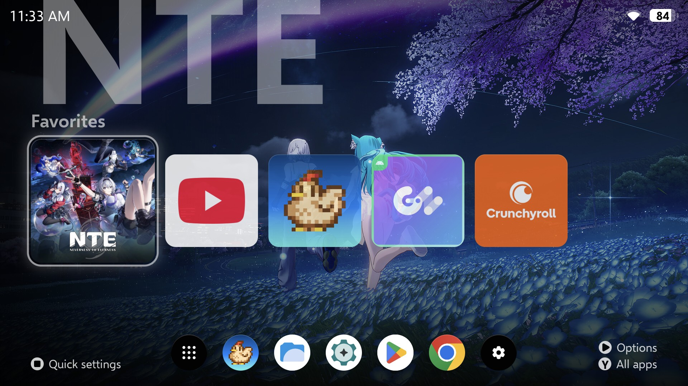
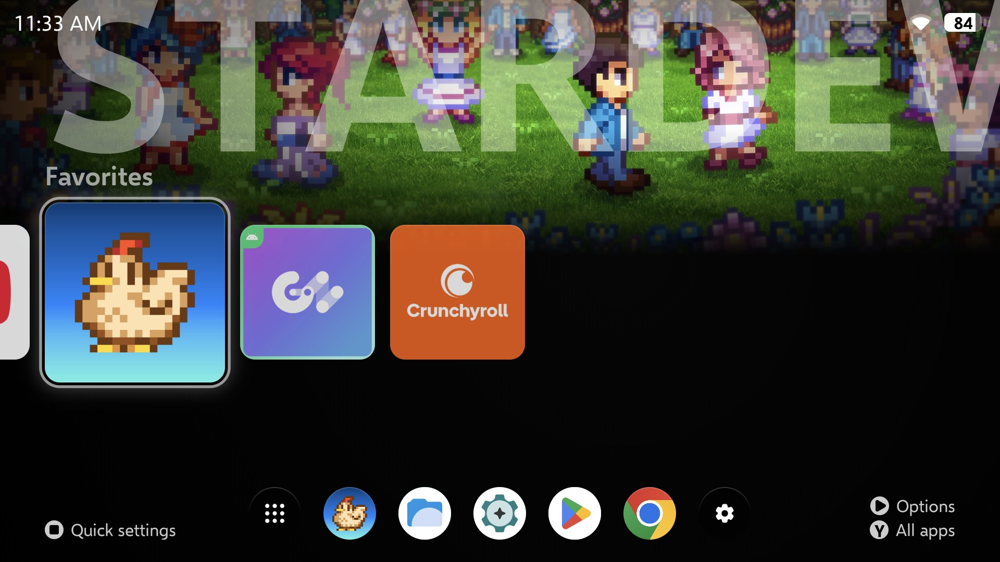
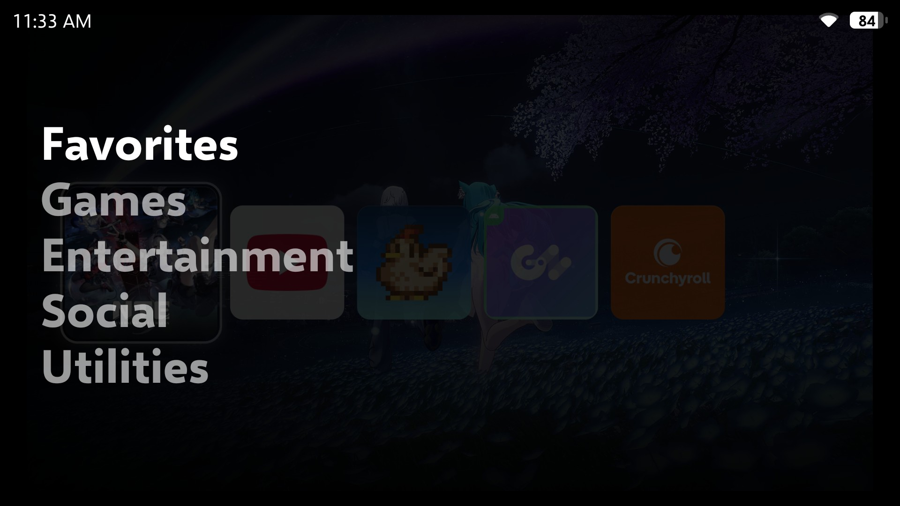
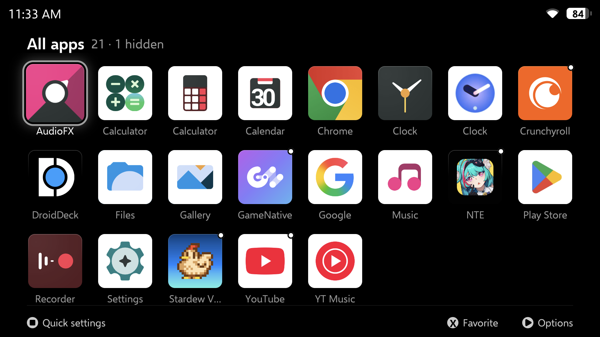
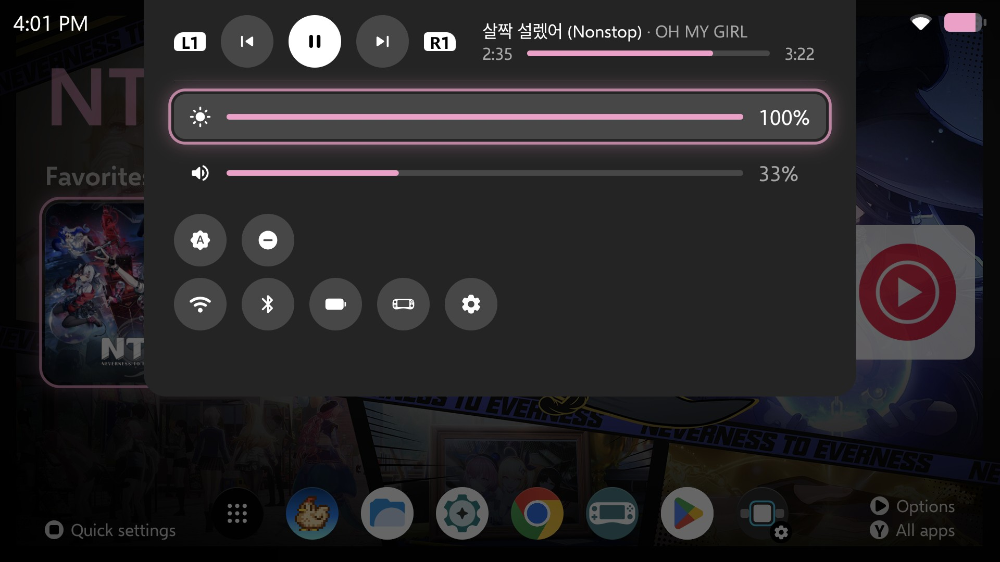
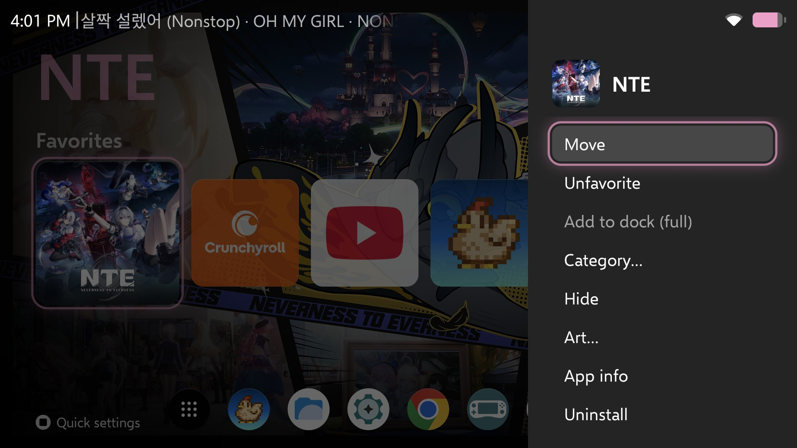
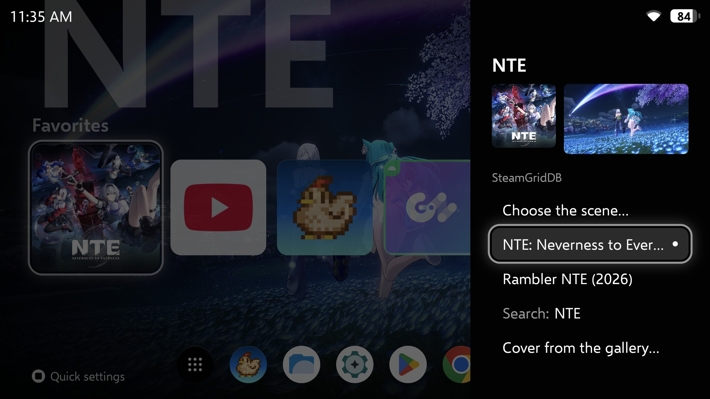
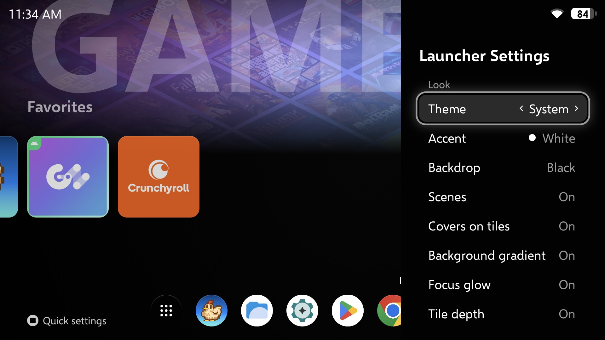

# Portal Launcher

**A calm, controller-first home screen for the AYN Odin 2 Portal.**
Your games up front with their art, every Android app one button away, nothing you don't need.



### [⬇ Download the latest APK](https://github.com/whatwhatwhoa/PortalLauncher/releases/latest)

Free, no ads, no account, no tracking. Android 12 or newer.

---

## Install in two minutes

Do this on the Portal itself.

1. **Download.** Open this page in the Portal's browser, tap **Download the latest APK** above,
   then tap `PortalLauncher-….apk` under *Assets*.
2. **Install.** Open the download. If Android says your browser isn't allowed to install apps,
   tap **Settings**, switch on **Allow from this source**, go back, and tap **Install**.
   If Play Protect warns about an unknown app, tap **Install anyway**.
3. **Make it your Home.** Open **Portal** from your app list. It asks once to be your Home app:
   pick **Portal** and confirm. From now on the Home button brings you here.
4. **Add your art** (optional, about a minute): see [Game art](#game-art) below.

**Updating:** download the new APK and install it over the old one, or let Portal do it (see
[Good to know](#good-to-know)). Your favorites, dock, art and settings stay.

**Going back to your old launcher:** Android **Settings → Apps → Default apps → Home app**, and
pick the old one. Portal stays installed until you uninstall it.

## Find your way around

| Button | On Home | In All apps |
|---|---|---|
| **A** | Open the app | Open the app |
| **B** | Categories: pick one, or **Triangle** to edit them | Back to Home |
| **Y** | All apps | Back to Home |
| **X** | — | Favorite / unfavorite |
| **Triangle** (Start) | Options for this app: favorite, move, dock, category, hide, art, uninstall | Same |
| **Square** (Select) | Quick settings | Quick settings |
| **L1 / R1** | Previous / next category (or tracks, with *Home screen play controls*) | Jump to the previous / next letter |
| **L2 / R2** | First / last app | First / last app |
| **R3** | Play / pause, with *Home screen play controls* | — |
| **Hold Home** | [Standby](#standby), from anywhere, once switched on | Same |

Touch works everywhere too: tap to open, long-press for options, swipe up for All apps.

- **Favorites** are your Home row. Press **X** on an app in All apps, or **Triangle → Favorite**.
  **Triangle → Move** puts a favorite where you want it.
- **The dock** along the bottom holds up to six everyday apps (mail, files, the store).
  **Triangle → Add to dock** on any app (grayed out once the dock is full); **Triangle → Move in dock** changes
  the order. The gear at the end opens **Launcher Settings**.
- **Categories:** Home shows one at a time: Favorites, Games, Entertainment, Social, Utilities.
  Games, video and music apps sort themselves; move any app with **Triangle → Category…** (it can be in
  several). Press **B** for the list, then **Triangle** to rename, reorder or delete a category, or to
  add your own.
- **Hide** an app you never open with **Triangle → Hide**. Launcher Settings → Apps → *Hidden apps*
  shows them again.

## Game art

Portal can fetch a cover and a header picture for your games from
[SteamGridDB](https://www.steamgriddb.com), plus a full-screen scene from the game's Steam store
page. It needs a free SteamGridDB key, which is yours and stays on your Portal:

1. In the Portal's browser, sign in at [steamgriddb.com](https://www.steamgriddb.com) (a Steam
   account works).
2. Open [Preferences → API](https://www.steamgriddb.com/profile/preferences/api), create a key,
   and **copy** it.
3. Back on Home, open **Launcher Settings** (the gear at the end of the dock), go to
   **Art → SteamGridDB key** and press **A**. It reads the key you copied and checks it. When the
   row says **Set**, you're done.

Art then arrives on its own for your favorites and games. For any other app, or to pick a
different picture, press **Triangle → Art…**: the art in use is at the top, the matches below. Go up
to the preview, pick the cover or the wide picture, and press **A** to browse every choice for
it; **L1 / R1** switch the wide one between a header and a full-screen scene. You can also use
any picture from your gallery as a cover or scene (the *Gallery…* tile), with or without a key.

**No art showing up?** If your Portal runs LineageOS, new apps may be kept offline. Open
**App info → Portal → Mobile data & Wi-Fi** and turn **Network access** on.

## Quick settings

Press **Square** for the music player (previous, play/pause, next, and a seek bar), brightness,
volume, auto-brightness and Do not disturb, plus shortcuts to Wi-Fi, Bluetooth, battery, AYN's
settings (*Controller settings*) and Android's settings. **L1** and **R1** skip tracks while the
panel is open; on the seek bar, left and right jump 10 seconds.
The first time you use brightness, Do not disturb or the seek bar, Portal opens the Android page
that lets it change them. Switch Portal on there once, then press **B** to come back. The seek
bar needs *Notification access*, which Android asks for to show what is playing; Portal reads no
notifications. With it, what is playing also shows beside the clock on Home.

## Standby

Hold **Home** for a rest that doesn't lock the Portal: the clock and battery on black, the
screen kept on, whatever you were doing (a game too) waiting underneath. Press the **same
button four times** to come back; touches, the sticks and the triggers don't count, so it won't
wake in a bag. A short press of Home works as always.

To switch it on: **Launcher Settings → Home → Hold Home for standby**, press **A**, and turn on
**Portal: hold Home for standby** in the Android list that opens (its row flashes). Android warns
that an accessibility service can see your screen and control the device. This one is only allowed to
receive the Home button: it can't read anything on the screen, and the code is here to check.

**Switch grayed out?** Android restricts it for apps installed from a downloaded file. Come back
to Launcher Settings: the row says *Restricted*. Press **A** for Portal's App info, then
**⋮ → Allow restricted settings**, and switch it on as above.

**Off again by itself?** Android switches it off whenever Portal is force-stopped. The next
time you press Home, a note at the top says so; switch it on again as above. To have Portal turn
it back on by itself, and switch it right in Launcher Settings, give it permission once from a
computer with [adb](https://developer.android.com/tools/adb):

```
adb shell pm grant io.github.whatwhatwhoa.portallauncher android.permission.WRITE_SECURE_SETTINGS
```

It lets Portal change Android's secure settings; it uses it only for this switch. Uninstalling
Portal takes the permission away.

## Make it yours

**Launcher Settings** (the dock's gear, or **Triangle → Launcher settings…**) changes everything live,
sorted into categories (move through them on the left, **A** to go in, **B** to come back out,
**L1 / R1** to turn the page):

- **Look:** theme (light, dark or follow the system), accent color (eight presets or your own),
  backdrop, covers on tiles, the big name (*Metro*, large and faint, or *Fitted*, the whole
  title), and the glow, depth, reflection and pulse effects.
- **Home:** the clock format, battery percent, button hints, whether the row wraps round, where
  the Home button takes you, *Home screen play controls*, and standby.
- **Sound:** soft sounds as you move around, in three styles and four volumes, or off. They
  follow the media volume and stay quiet in Do not disturb.
- **Art:** your SteamGridDB key, whether art is fetched by itself, and clearing it all.
- **Apps:** hidden apps, and putting the dock back as it was.
- **System:** the Home app, Android's settings, updates, and saving or restoring your setup.

## Screenshots

| | |
|---|---|
|  |  |
| *Home: the focused game's scene fills the screen* | *B: switch category* |
|  |  |
| *Y: every app, A–Z* | *−: quick settings* |
|  |  |
| *Triangle: options for any app* | *Triangle → Art…: pick a cover, header or scene* |
|  | |
| *Launcher Settings, applied live* | |

## Good to know

- **Made for the Odin 2 Portal** (7" 1920×1080, landscape). Other landscape Android handhelds
  should work, since the layout scales to fit, but only the Portal is tested. Phones aren't
  supported; in portrait, Home shows letterboxed across the middle of the screen.
- **Any display size works.** Portal fits itself to Android's *Display size* or *Smallest
  width*, whatever you set, and adjusts at once when you change it. No setup needed.
  **Tip:** set *Smallest width* to **600** (Settings → System → Developer options) and your
  other apps open in their tablet layouts, with more on screen. Portal looks the same either
  way. To go back, set it to the number it showed before.
- **Updates:** Launcher Settings → System → Updates says when a newer version is out; A
  downloads and installs it, keeping your setup. The first time, Android asks you to allow
  Portal to install apps.
- **Your setup** (favorites, dock, categories, settings, art choices): updates keep it. Before
  uninstalling, Launcher Settings → System → *Save setup* puts it in one file in Download;
  *Restore setup* brings it back, then art downloads again. Your SteamGridDB key isn't in the
  file: paste it again after a fresh install.
- **Privacy:** Portal uses the internet only for art, SteamGridDB (with your key) and Steam's
  public store pages, and to ask GitHub for a newer version when you open Launcher Settings.
  Nothing else leaves your device, and there are no analytics.
- **Early days:** Portal isn't at 1.0 yet. If something looks off, please
  [open an issue](https://github.com/whatwhatwhoa/PortalLauncher/issues) with a photo or
  screenshot.
- Not affiliated with AYN, Valve or SteamGridDB.

## Credits

- Font: [Selawik](https://github.com/microsoft/Selawik), SIL Open Font License
  ([text](licenses/Selawik-OFL.txt)).
- Icons: [Material Symbols](https://fonts.google.com/icons), Apache License 2.0
  ([text](licenses/MaterialSymbols-Apache-2.0.txt)).
- Sounds: made for Portal ([tools/sounds](tools/sounds/make_sounds.py)).
- Game art comes from [SteamGridDB](https://www.steamgriddb.com) and the Steam store. The art in
  the screenshots belongs to the games' makers.

Portal Launcher is open source under the [MIT License](LICENSE).

**Building it yourself:** with JDK 21 and the Android SDK (platform 37), run
`./gradlew assembleDebug` and install `app/build/outputs/apk/debug/app-debug.apk`. A release
build (`./gradlew assembleRelease`) is signed only when `local.properties` names your own key
(`release.storeFile`, `release.storePassword`, `release.keyAlias`, `release.keyPassword`). A build
you sign yourself can't update the published APK or be updated by it: *Save setup*, uninstall
one, then install the other. The toolchain: [docs/device.md](docs/device.md) (*Toolchain*).
