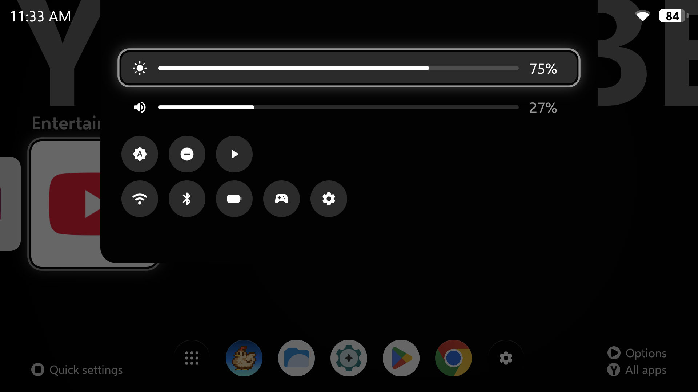

# Portal Launcher

**A calm, controller-first home screen for the AYN Odin 2 Portal.**
Your games up front with their art, every Android app one button away, nothing you don't need.

### [⬇ Download the latest APK](https://github.com/whatwhatwhoa/PortalLauncher/releases/latest)

Free, no ads, no account, no tracking. Android 12 or newer.

---

## Install in two minutes

Do this on the Portal itself.

1. **Download.** Open this page in the Portal's browser, tap **Download the latest APK** above,
   then tap `PortalLauncher-….apk` under *Assets*.
2. **Install.** Open the download. If Android says your browser isn't allowed to install apps,
   tap **Settings**, switch on **Allow from this source**, go back, and tap **Install**.
   If Play Protect warns about an unknown app, tap **Install anyway**.
3. **Make it your Home.** Open **Portal** from your app list. It asks once to be your Home app:
   pick **Portal** and confirm. From now on the Home button brings you here.
4. **Add your art** (optional, about a minute): see [Game art](#game-art) below.

**Updating:** download the new APK and install it over the old one. Your favorites, dock,
art and settings stay.

**Going back to your old launcher:** Android **Settings → Apps → Default apps → Home app**, and
pick the old one. Portal stays installed until you uninstall it.

## Find your way around

| Button | On Home | In All apps |
|---|---|---|
| **A** | Open the app | Open the app |
| **B** | Switch category (Favorites, Games, Entertainment, Social, Utilities) | Back to Home |
| **Y** | All apps | — |
| **X** | — | Favorite / unfavorite |
| **+** (Start) | Options for this app: favorite, move, dock, category, hide, art, uninstall | Same |
| **−** (Select) | Quick settings | Quick settings |
| **L1 / R1** | — | Jump to the previous / next letter |
| **L2 / R2** | First / last app | First / last app |

Touch works everywhere too: tap to open, long-press for options, swipe up for All apps.

- **Favorites** are your Home row. Press **X** on an app in All apps, or **+ → Favorite**.
- **The dock** along the bottom holds up to six everyday apps (mail, files, the store).
  **+ → Add to dock** on any app. The gear at the end opens **Launcher Settings**.
- **Categories:** games, video and music apps sort themselves. Move one with **+ → Category…**.

## Game art

Portal can fetch a cover and a header picture for your games from
[SteamGridDB](https://www.steamgriddb.com), plus a full-screen scene from the game's Steam store
page. It needs a free SteamGridDB key, which is yours and stays on your Portal:

1. In the Portal's browser, sign in at [steamgriddb.com](https://www.steamgriddb.com) (a Steam
   account works).
2. Open [Preferences → API](https://www.steamgriddb.com/profile/preferences/api), create a key,
   and **copy** it.
3. Back on Home, open **Launcher Settings** (the gear at the end of the dock), go to
   **Art → SteamGridDB key** and press **A**. It reads the key you copied and checks it. When the
   row says **Set**, you're done.

Art then arrives on its own for your favorites and games. For any other app, or to pick a
different picture, press **+ → Art…**. You can also use any picture from your gallery as a cover
or scene, with or without a key.

**No art showing up?** If your Portal runs LineageOS, new apps may be kept offline. Open
**App info → Portal → Mobile data & Wi-Fi** and turn **Network access** on.

## Quick settings

Press **−** for the music player (previous, play/pause, next, and a seek bar), brightness,
volume, auto-brightness and Do not disturb, plus shortcuts to Wi-Fi, Bluetooth, battery, AYN's
settings and Android's settings. **L1** and **R1** skip tracks while the panel is open.
The first time you use brightness, Do not disturb or the seek bar, Portal opens the Android page
that lets it change them. Switch Portal on there once, then press **B** to come back. The seek
bar needs *Notification access*, which Android asks for to show what is playing; Portal reads no
notifications.

## Make it yours

**Launcher Settings** (the dock's gear, or **+ → Launcher settings…**) changes everything live:
theme (light, dark or follow the system), accent color, backdrop, covers on tiles, glow
and depth effects, the clock format, button hints, and what the Home button does.

## Screenshots

| | |
|---|---|
|  |  |
| *Home: the focused game's scene fills the screen* | *B: switch category* |
|  |  |
| *Y: every app, A–Z* | *−: quick settings* |
|  |  |
| *+: options for any app* | *+ → Art…: pick a cover, header or scene* |
|  | |
| *Launcher Settings, applied live* | |

## Good to know

- **Made for the Odin 2 Portal** (7" 1920×1080, landscape). Other landscape Android handhelds
  should work, since the layout scales to fit, but only the Portal is tested. Phones and
  portrait aren't supported.
- **Updates:** Launcher Settings → System → Updates says when a newer version is out; A
  downloads and installs it, keeping your setup. The first time, Android asks you to allow
  Portal to install apps.
- **Privacy:** Portal uses the internet only for art, SteamGridDB (with your key) and Steam's
  public store pages, and to ask GitHub for a newer version when you open Launcher Settings.
  Nothing else leaves your device, and there are no analytics.
- **Early days:** this is version 0.1. If something looks off, please
  [open an issue](https://github.com/whatwhatwhoa/PortalLauncher/issues) with a photo or
  screenshot.
- Not affiliated with AYN, Valve or SteamGridDB.

## Credits

- Font: [Selawik](https://github.com/microsoft/Selawik), SIL Open Font License
  ([text](licenses/Selawik-OFL.txt)).
- Icons: [Material Symbols](https://fonts.google.com/icons), Apache License 2.0
  ([text](licenses/MaterialSymbols-Apache-2.0.txt)).
- Game art comes from [SteamGridDB](https://www.steamgriddb.com) and the Steam store. The art in
  the screenshots belongs to the games' makers.

Portal Launcher is open source under the [MIT License](LICENSE). Building it yourself:
see [docs/architecture.md](docs/architecture.md) (*Toolchain*) and run
`./gradlew assembleRelease` with JDK 21.
